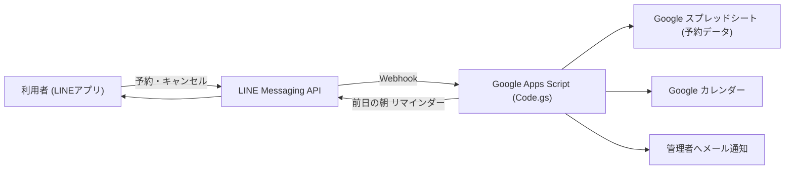

# LINE予約システム (Google Apps Script)

LINE上で予約の受付からリマインダー送信までを完結させる、個人・小規模事業者向けの予約システムです。Google Apps Script（JavaScript）だけで動き、予約データは Google スプレッドシートに保存します。サーバーやデータベースは不要です。

> サンプルは家庭教師（自宅訪問型の個別指導）向けの設定になっています。講座名・料金・営業ルールなどを書き換えれば、他の業種にも転用できます。

## 仕組みの流れ



## 何をするコードか

- LINEのトーク上で、ボタンやカレンダーを使った対話形式で予約を受け付ける
- 予約内容を Google スプレッドシートに自動記録する
- 営業時間・曜日・休業日（「予約不可設定」シート）に応じて予約可否を自動判定する
- 空き状況を月カレンダー（〇=空きあり / △=残りわずか / ×=不可）で表示する
- 前日の朝に、翌日の予約者へリマインダーと支払い案内を自動送信する
- 料金を自動計算する（初回 / 2回目以降で単価が変わる）
- 予約のキャンセルを受け付ける（前日まで。枠は自動で空きに戻る）
- 予約確定時に Google カレンダーへ予定を自動登録、キャンセル時に自動削除する
- 新規予約・キャンセルを管理者へメール通知する（任意でLINE通知も可）

## 必要なもの

- Google アカウント（Google Apps Script / スプレッドシート / カレンダー / Gmail）
- LINE 公式アカウントと Messaging API チャネル（チャネルアクセストークン）
- 予約データ保存用の Google スプレッドシート

## 構成

```
line-reservation-gas/
├── README.md
├── .env.example          # 必要な設定項目の一覧（実行時には読まれません。控え用）
├── .gitignore
├── appsscript.json       # GAS マニフェスト（タイムゾーン・Webアプリ設定）
├── src/
│   └── Code.gs           # 本体（全ロジック）
└── sample/               # 動作イメージ用のダミーデータ（本物は含みません）
    ├── reservations_sample.csv    # 「予約一覧」シートの例
    └── blocked_slots_sample.csv   # 「予約不可設定」シートの例
```

## セットアップ

1. **スプレッドシートを用意する**
   予約保存用の Google スプレッドシートを作成し、その ID（URL の `/d/` と `/edit` の間の文字列）を控えます。シート構成は `sample/` の CSV を参考にしてください（シートはコードが自動生成します）。

2. **Apps Script プロジェクトを作成する**
   [script.google.com](https://script.google.com/) で新規プロジェクトを作り、`src/Code.gs` の内容を貼り付けます。`appsscript.json` の内容も合わせておくと確実です。

3. **設定値を登録する（重要）**
   秘密情報はコードに書かず、**プロジェクトの設定 → スクリプト プロパティ**に登録します。項目は `.env.example` を参照してください。

   | キー | 必須 | 内容 |
   |------|------|------|
   | `CHANNEL_ACCESS_TOKEN` | ✅ | LINE Messaging API のチャネルアクセストークン（長期） |
   | `SPREADSHEET_ID` | ✅ | 予約データを保存するスプレッドシートの ID |
   | `SHEET_NAME` | 任意 | 予約一覧シート名（未設定なら「予約一覧」） |
   | `ADMIN_EMAIL` | 任意 | 管理者の通知先メールアドレス |
   | `ADMIN_USER_ID` | 任意 | 管理者の LINE ユーザーID（LINE通知を使う場合のみ） |

4. **Webアプリとしてデプロイする**
   「デプロイ → 新しいデプロイ → 種類: ウェブアプリ」。アクセスを「全員」にしてデプロイし、発行された `/exec` URL を控えます。

5. **LINE側に Webhook を設定する**
   LINE Developers コンソールで、Messaging API の Webhook URL に 4 の `/exec` URL を登録し、Webhook を ON、応答メッセージを OFF にします。

6. **リマインダーを有効化する（任意）**
   `/exec?setup=reminder` に一度アクセスするか、GAS のトリガー画面で `sendReminders` を「日タイマー（朝の時間帯）」で登録します。

## 使い方

- 利用者が LINE で「予約」と送ると、対話形式で予約が進みます。
- 「キャンセル」と送ると、自分の予約一覧から前日まで取り消せます。
- オーナーは「予約不可設定」シートに印を付けることで、休業日や埋めたい時間帯をブロックできます（曜日指定・終日休みにも対応）。

## 設定のカスタマイズ

`src/Code.gs` 冒頭の設定値で、営業ルールや料金を調整できます（例）。

- `SLOT_START_MIN` / `SLOTS_PER_DAY` … 予約開始時刻の範囲
- `LEAD_DAYS` … 何日前まで予約を受け付けるか
- `MONTHS_AHEAD` … 何か月先まで予約可能か
- `COURSE_MIN` / `PRICE_FIRST` / `PRICE_REPEAT` … 講座の所要時間・料金
- `PAYMENT_INFO` … 支払い案内文（**ダミー値。自分の口座に書き換えてください**）
- `CALENDAR_ID` … 登録先カレンダー（空ならメインカレンダー）

## 注意

- 本リポジトリに**実際の予約データや個人情報を含めないでください**（`.gitignore` で `data/` などを除外しています）。
- LINE の無料プランではプッシュ送信に月あたりの上限があります。リマインダー等の送信量が多い場合はプランや設計を見直してください。

## 著作権・利用について

© 2026 onuma-h. All rights reserved.

このリポジトリは閲覧・参考のために公開しています。
コードの複製・改変・再配布・その他の利用には、作者の許可が必要です。
本コードの利用によって生じたいかなる損害についても、作者は責任を負いません。
